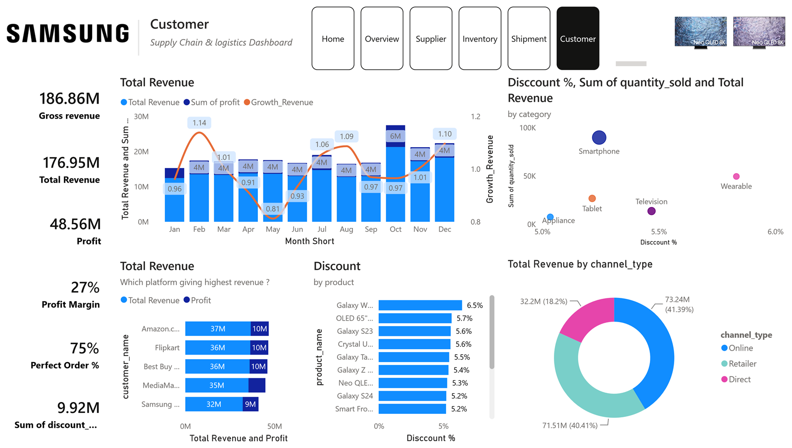

# Samsung Supply Chain Analytics

A Power BI supply chain and logistics report for a consumer electronics business, built on a star-schema model that connects procurement, production, inventory, shipment, and sales data.



## Overview

| Item | Detail |
|---|---|
| Pages | Home, Overview, Supplier, Inventory, Shipment, Customer |
| Tooling | Power BI Desktop, DAX, advanced slicers, page navigation |
| Model | 5 dimensions and 5 fact tables |
| Grain | Monthly transactions across facilities, products, suppliers, and customers |

## Report pages

- **Home** - navigation hub with page cards.
- **Customer** - the developed analysis page: gross revenue, total revenue, profit, profit margin, perfect order rate, revenue and profit by customer, monthly revenue with growth, discount against units sold by category, discount by product, and revenue by channel.
- **Overview**, **Supplier**, **Inventory**, **Shipment** - supporting pages wired to the same model, with supplier lead-time, defect-rate, and carrier-delay views. These pages are structured but not yet fully populated; extending them is the next stage of the build.

The Customer page combines KPI cards, a stacked column and line chart, a scatter, bar charts, a donut, an advanced slicer, and a page navigator for consistent movement through the report.

## Data model

**Dimensions**

`dim_customer` (5 rows), `dim_date` (731), `dim_facility` (6), `dim_product` (16), `dim_supplier` (7).

**Facts**

| Table | Rows | Description |
|---|---:|---|
| `fact_inventory` | 1,152 | Stock snapshots by product and facility |
| `fact_procurement` | 2,200 | Purchase orders and supplier transactions |
| `fact_production` | 4,500 | Production runs and output |
| `fact_sales` | 8,500 | Sales orders and revenue |
| `fact_shipment` | 7,500 | Shipment and delivery records |

The raw CSV files are included in `data/` so the model can be rebuilt or extended.

## Repository contents

```text
samsung-supply-chain-analytics/
|-- Samsung_Supply_Chain_Analytics.pbix
|-- assets/
|   `-- dashboard.png
|-- data/
|   |-- dim_customer.csv
|   |-- dim_date.csv
|   |-- dim_facility.csv
|   |-- dim_product.csv
|   |-- dim_supplier.csv
|   |-- fact_inventory.csv
|   |-- fact_procurement.csv
|   |-- fact_production.csv
|   |-- fact_sales.csv
|   `-- fact_shipment.csv
`-- README.md
```

## How to open

1. Open `Samsung_Supply_Chain_Analytics.pbix` in Power BI Desktop.
2. Allow custom visuals if prompted; the report uses an advanced slicer visual.
3. Start on **Home** and use the page navigator.

## Data notes

- The dataset is a representative supply chain model; company and customer names are illustrative.
- This project is not affiliated with or endorsed by Samsung.

## Author

**Mohamed Mahmoud Taha** - Financial Analyst | Data Analyst

GitHub: [momahmoud02](https://github.com/momahmoud02)
